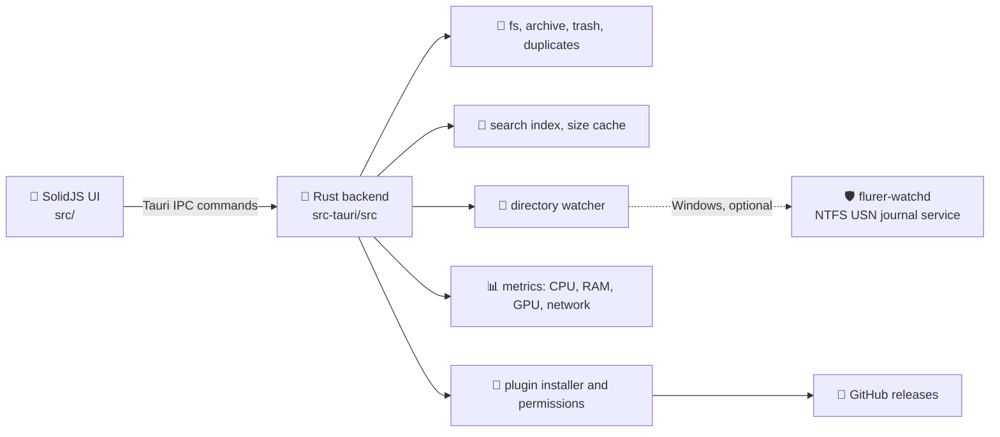

# 📁 Flurer


A lightweight, fast file manager built with [Tauri v2](https://tauri.app) (Rust) and [SolidJS](https://solidjs.com). It uses the OS's own webview (WebView2 on Windows, WebKitGTK on Linux) instead of bundling Chromium, so it starts quickly and uses little memory. The look follows Windows 11 Fluent Design, with acrylic and mica style translucent surfaces.

---

## ✨ Features

| | Feature |
|---|---|
| ⚡ | **Fast browsing.** Async Rust file operations, chunked directory streaming, metadata caching and background folder-size calculation. Details and grid views. |
| 🗂️ | **Tabs and dual pane.** Browse in tabs, or open a second independent pane side by side and send the selection across. |
| 🔎 | **Search.** Filename search, plus content search by starting the query with `>`. An optional search index speeds it up. |
| 🧰 | **Everyday tools.** Bulk rename, duplicate finder, Quick Look and preview panel, properties dialog, trash view, and zip compress and extract. |
| ⌨️ | **Keyboard first.** A command palette (`Ctrl+K`) and rebindable shortcuts, such as `F2` rename, `Ctrl+L` address bar, `Ctrl+T` new tab and `Ctrl+Shift+D` new pane. |
| 📊 | **Live system metrics** in a customizable top bar: CPU, RAM, GPU and network. |
| 🔌 | **Plugins** installed from GitHub releases (see below). |
| 🖥️ | **Terminal and PATH integration.** Open your terminal in the current folder (`foot`, `ghostty`, `alacritty`, `kitty`, `konsole`, `gnome-terminal`, `xterm` or `cmd.exe`), and add `flurer` to your `PATH` from Settings. |
| 🛡️ | **Run as admin.** Windows elevation, and `pkexec` on Linux, with the elevated app detached into its own service so it stays responsive. |
| 🔗 | **Safe symlink handling.** No infinite recursion and no false access-denied warnings. |
| 🎨 | **Themes and customization.** Six themes (Light, Dark, Midnight, Ocean, Nord, Paper), custom backgrounds (including rotating Unsplash images), and per-plugin translucency. |
| 🔄 | **Auto-update.** The app finds new releases and can install them for you. |

---

## 🔌 Plugins

Plugins extend Flurer in four places: a button on the left **view rail**, a replacement **sidebar**, a **main panel** or **full panel** view, and their own **settings page**. They ask for permission before using sensitive features.

Install them from **Settings → Plugin Marketplace** with a GitHub repo (`owner/repo`, which fetches the latest release's `.zip`) or a `.zip` file from disk. Plugins live in `~/.config/flurer/plugins/<id>/`.

| Plugin | What it does |
|---|---|
| [flurer-plugin-git](https://github.com/sahuishan01/flurer-plugin-git) | Git status, stage and unstage, commit, push and pull |
| [flurer-graph-plugin](https://github.com/sahuishan01/flurer-graph-plugin) | Treemap-style storage graph for exploring disk usage |
| [flurer-web-loader](https://github.com/sahuishan01/flurer-web-loader) | Loads web pages and local web apps in a window |

Writing your own? See [plugin-spec.md](plugin-spec.md) for the manifest, build requirements and API.

---

## 🗺️ Architecture



Filesystem work, background size caching and native bindings live in Rust and are exposed to the frontend as Tauri commands. `src-tauri/watchd` is a small elevated helper that reads the NTFS USN journal for volume-wide change detection, so the main app can stay unprivileged. See the [design note](docs/superpowers/specs/2026-08-16-usn-journal-watcher-design.md) for why, and for its verification status.

---

## 🚀 Getting started

### Prerequisites

- **Rust** and Cargo ([rustup](https://rustup.rs))
- **Node.js** and **Bun**
- **Linux:** WebKitGTK and GTK3 development libraries
  - Ubuntu/Debian: `sudo apt install libwebkit2gtk-4.1-dev build-essential curl wget file libssl-dev libgtk-3-dev libayatana-appindicator3-dev librsvg2-dev`
  - Arch: `sudo pacman -S webkit2gtk-4.1 base-devel curl wget openssl gtk3 libappindicator-gtk3 librsvg`
- **Windows:** the `x86_64-pc-windows-msvc` Rust toolchain and the WiX Toolset (for `.msi` installers)

### Run in development

```bash
git clone https://github.com/sahuishan01/Flurer.git
cd Flurer
bun install
bun run tauri dev
```

### Build installers

```bash
bun run tauri build
```

Installers are written to `src-tauri/target/release/bundle/`:

| Platform | Output |
|---|---|
| 🪟 Windows | `.msi` (per-machine) and `.exe` NSIS (per-user or per-machine, your choice at install time) |
| 🐧 Linux | `.deb`, `.rpm` and `.AppImage` |

See [build.md](build.md) for versioning and packaging details.

---

## 🤝 CI and releases

- `.github/workflows/build.yml` validates the Linux and Windows builds on push.
- `.github/workflows/release.yml` builds on Windows and Ubuntu when a `v*` tag is pushed, creates the GitHub Release with a changelog, and attaches the installers.

---

## 🧭 For contributors and AI agents

- [AGENTS.md](AGENTS.md), [CLAUDE.md](CLAUDE.md) and [HANDOFF.md](HANDOFF.md) hold project conventions, roadmap and recent history.
- [DESIGN.md](DESIGN.md) has the visual design tokens.
- Design specs for larger features are in [docs/superpowers/specs](docs/superpowers/specs).
- The repo is indexed with **GitNexus** for code navigation and impact analysis:

```bash
gitnexus analyze                       # re-index
gitnexus query "<concept>"             # find a concept or execution flow
gitnexus impact --target "<symbol>"    # blast radius before refactoring
```
